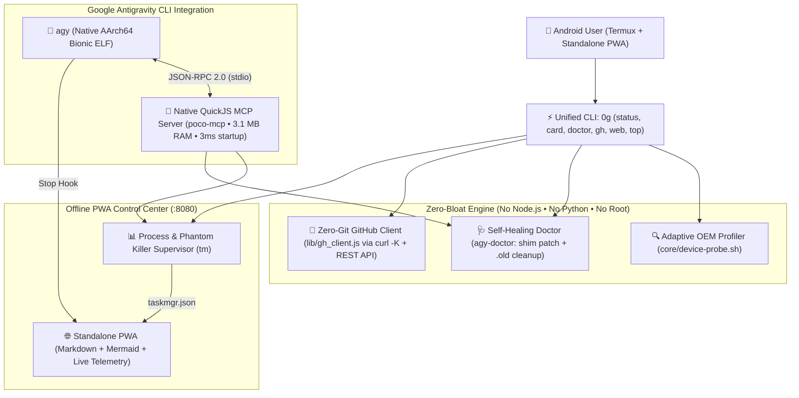

# 🚀 ZeroG (`0g` / `zerog-termux`)

**Zero Gravity. Zero Bloat. Autonomous AI Coding Station for Google Antigravity CLI (`agy`) on Android Termux.**

[-3fb950?style=flat-square)](#)
[](#)
[](#)
[](LICENSE)

---

## ⚡ Why ZeroG?

Modern AI agent toolchains assume you are on a 64 GB desktop and spawn heavy **Node.js** or **Python** MCP servers consuming 500–800 MB of RAM and dozens of child processes.

On **Android 12–16 (Xiaomi HyperOS, MIUI, Samsung OneUI, Pixel UI)** inside Termux without root, that approach crashes within minutes:
1. **Android Phantom Process Killer** enforces a strict ceiling of **32 concurrent child processes** per UID (`SIGKILL`).
2. **Broken `/usr/local/bin/language_server_shim`** in `agy`'s `agentapi` wrapper fails on Termux (`$PREFIX` is `/data/data/com.termux/files/usr`) and gets overwritten on every CLI update.
3. **Stale `agy.*.old` binary backups (~180 MB each)** silently fill internal storage after self-updates.

**ZeroG (`0g`)** solves all of these with a **3.1 MB RAM native QuickJS MCP server**, an **Android Phantom Process supervisor**, a **self-healing CLI doctor**, a **zero-git GitHub REST API client**, and an **Offline Standalone PWA Control Center**.

---

## 🏗️ Architecture



---

## 📦 Key Features

* **🔌 Native QuickJS MCP Server (`poco-mcp`):**
  * Built in pure ES modules for `QuickJS-ng` (`qjs -m`) — **0 npm dependencies, ~3.15 MB RSS memory, 3 ms startup, 1 process**.
  * Exposes **6 MCP tools** to Google Antigravity (`poco_system_vitals`, `poco_doctor`, `poco_tasks`, `poco_processes`, `poco_brain_search`, `poco_viewer_sync`) and **3 live MCP resources** (`poco://vitals`, `poco://reports`, `poco://agents`).
* **👻 Android Phantom Process Killer Shield (`0g status` / `0g top`):**
  * Live gauge of your `N / 32` process ceiling, safe process terminator (`tm kill` guards PID 1, active shells, and `agy`), and automatic `termux-wake-lock` acquisition for Xiaomi HyperOS / MIUI.
* **🩺 Self-Healing Environment Doctor (`0g doctor` / `0g fix`):**
  * Automatically patches `agentapi` to work on Termux, caches `agy` version by binary `mtime`, and removes leftover 180 MB `agy.*.old` binaries after updates.
* **🐙 Zero-Git Native GitHub Client (`0g gh`):**
  * Connect to GitHub, list repos, create repos, and push files or entire directories directly via the GitHub REST API (`curl -K` protected config + `base64` + `QuickJS`) — without even installing `git`.
* **📲 Offline Standalone PWA Dashboard (`0g web`):**
  * Served by `darkhttpd` (< 1 MB RAM) at `http://127.0.0.1:8080`. Installable to your Android home screen with live Markdown + Mermaid diagram zoom, Agent Workspace inspector, and System Vitals.

---

## 🚀 Quick Start (Termux on Android)

```bash
# Required lightweight packages in Termux:
pkg install -y quickjs darkhttpd curl

# Run the adaptive installer:
bash install.sh

# Check your station status & generate a shareable passport card:
0g status
0g card
```

### Example Output (`0g card`)

```text
┏━━━━━━━━━━━━━━━━━━━━━━━━━━━━━━━━━━━━━━━━━━━━━━━━━━━━━━┓
┃ ⚡ ZEROG MOBILE AI STATION PASSPORT                  ┃
┣━━━━━━━━━━━━━━━━━━━━━━━━━━━━━━━━━━━━━━━━━━━━━━━━━━━━━━┫
┃ 📱 Device:    POCO X4 Pro 5G (2201116PG)             ┃
┃ 🛡️  OS / Skin: Xiaomi HyperOS 1.0 (Android 13)        ┃
┃ 🤖 AI Engine: Google Antigravity CLI v1.4.2          ┃
┃ 🔌 MCP Stack: QuickJS (qjs) stdio • 3MB RAM • 3ms    ┃
┃ 🧠 Memory:    3364MB / 5437MB (2073MB free)          ┃
┃ 👻 Phantom:   8 / 32 slots (24 free • OK)            ┃
┃ 💾 Storage:   68G / 102G (33G avail)                 ┃
┃ 🌐 PWA Hub:   http://127.0.0.1:8080 (Offline Ready)  ┃
┗━━━━━━━━━━━━━━━━━━━━━━━━━━━━━━━━━━━━━━━━━━━━━━━━━━━━━━┛
```

---

## ⌨️ CLI Reference (`0g` / `zerog`)

| Command | Description |
| :--- | :--- |
| `0g status` | Full station telemetry (RAM, Storage, Phantom Killer `N/32`, AGY Doctor) |
| `0g card` | Render shareable **ZeroG Mobile AI Station Passport** in terminal |
| `0g web` | Start & open the Offline Standalone PWA Control Center (`:8080`) |
| `0g doctor` / `0g fix` | Diagnose & repair `agentapi`, enable HyperOS WakeLock, purge `.old` binaries |
| `0g top` / `0g ps` | Live terminal process monitor & sorted process table |
| `0g tasks` / `0g run` | Manage supervised background jobs in Termux |
| `0g gh whoami` | Verify connected GitHub account via zero-git REST API |
| `0g gh create <name>` | Create a new GitHub repository from Termux |
| `0g gh push <repo> <path>` | Push a file or directory directly to GitHub via REST Contents API |

---

## 🇷🇺 Краткое описание на русском

**ZeroG (`0g` / `zerog-termux`)** — это сверхлегкая адаптивная среда и PWA-центр управления для запуска **Google Antigravity CLI (`agy`)** на смартфонах Android в Termux без Root, без Node.js, без Python и без Git:
* **Нативный MCP-сервер `poco-mcp` на QuickJS (`qjs`):** потребляет всего **3.15 МБ ОЗУ**, стартует за **3 мс** и занимает **1 слот** в лимите Android Phantom Process Killer (32 процесса).
* **Автодоктор `agy-doctor`:** автоматически лечит враппер `agentapi`, удерживает `termux-wake-lock` на Xiaomi HyperOS и удаляет 180-мегабайтные дубликаты `agy.*.old` после автообновлений.
* **Встроенный клиент GitHub (`0g gh`):** создает репозитории и выгружает файлы/папки напрямую через GitHub REST API (`curl -K` + `qjs`).

---

## 🧪 Testing (100% Test-Driven Development)

```bash
bash tests/test_zerog_distro.sh
```

## 📄 License

MIT © [LexGridnev](https://github.com/LexGridnev)
