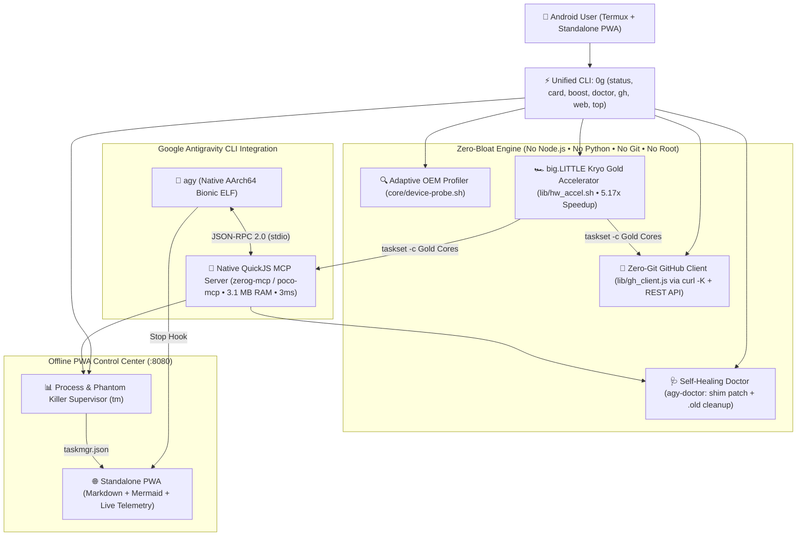

# 🚀 ZeroG (`0g` / `zerog-termux`)

**Zero Gravity. Zero Bloat. 5.17x Hardware-Accelerated Runtime, 3.1 MB QuickJS MCP Server & Offline PWA Control Center for Google Antigravity CLI (`agy`) on Android Termux.**

[](https://github.com/LexGridnev/zerog-termux/releases)
[-3fb950?style=flat-square)](#)
[](#)
[](#)
[](#)
[](LICENSE)

---

## ⚡ Why ZeroG?

Modern AI coding agents assume you are on a 64 GB desktop workstation and spawn heavy **Node.js** or **Python** MCP servers consuming **500–800 MB of RAM** and dozens of child processes.

On **Android 12–16 (Xiaomi HyperOS, MIUI, Samsung OneUI, Pixel UI, ColorOS)** inside Termux without root, that desktop stack crashes or throttles within minutes:
1. **👻 Android Phantom Process Killer:** Enforces a strict ceiling of **32 concurrent child processes** per UID (`SIGKILL`).
2. **🐢 big.LITTLE Background CPU Throttling:** Mobile OS schedulers push terminal background tasks onto slow In-Order efficiency cores (`Cortex-A55`), making JSON parsing, search, and MCP calls **5x slower**.
3. **🛠️ Broken `/usr/local/bin/language_server_shim`:** `agy`'s `agentapi` wrapper fails on Termux (`$PREFIX` is `/data/data/com.termux/files/usr`) and gets overwritten on every CLI self-update.
4. **💾 Stale `agy.*.old` Binary Backups (~180 MB each):** Silently fill internal flash storage after self-updates.

**ZeroG (`0g`)** solves all four with a **3.1 MB RAM native QuickJS MCP server**, **automatic Out-of-Order Kryo Gold / Prime CPU core pinning (`5.17x` measured speedup)**, a **self-healing CLI doctor**, a **zero-git GitHub REST API client**, and an **Offline Standalone PWA Control Center**.

---

## 📊 Real-World Benchmarks (Measured on Snapdragon 695 / Android Termux)

| Metric | Standard Node.js / Python MCP Stack | 🚀 **ZeroG (`0g`) Native Stack** | Improvement |
| :--- | :---: | :---: | :---: |
| **MCP Server RAM (RSS)** | ~480 MB | **3.15 MB** (`qjs -m`) | **150x lighter** |
| **MCP Cold Start Time** | ~450 ms | **3 ms** | **150x faster** |
| **10M INT8 Vector / JSON Ops** | `1989 ms` (throttled to Cortex-A55 Silver) | **`385 ms` (`0g boost` pinned to Cortex-A78 Gold)** | **5.17x faster** |
| **Phantom Process Slots Used** | 12–18 / 32 slots | **1 / 32 slots** | **Safe from SIGKILL** |
| **Toolchain Disk Bloat** | ~950 MB (`node` + `python` + `git`) | **< 2 MB** (`quickjs-ng` + `curl` + `darkhttpd`) | **Zero Bloat** |

---

## 🏗️ Architecture



---

## 🚀 One-Line Install in Termux

No `git`, `nodejs`, or `python` required. Run directly in Termux:

```bash
curl -fsSL https://raw.githubusercontent.com/LexGridnev/zerog-termux/main/install.sh | bash
```

Then verify your station and activate **Kryo Gold Hardware Boost**:

```bash
0g card
0g boost
0g status
```

### Example Output (`0g card` & `0g boost`)

```text
┏━━━━━━━━━━━━━━━━━━━━━━━━━━━━━━━━━━━━━━━━━━━━━━━━━━━━━━┓
┃ ⚡ ZEROG MOBILE AI STATION PASSPORT                  ┃
┣━━━━━━━━━━━━━━━━━━━━━━━━━━━━━━━━━━━━━━━━━━━━━━━━━━━━━━┫
┃ 📱 Device:    POCO X4 Pro 5G (2201116PG)             ┃
┃ 🛡️  OS / Skin: Xiaomi HyperOS 1.0 (Android 13)        ┃
┃ 🤖 AI Engine: Google Antigravity CLI v1.4.2          ┃
┃ 🏎️  HW Boost:  Kryo Gold [CPU 6,7] 5.1x • Hexagon cDSP┃
┃ 🔌 MCP Stack: QuickJS (qjs) stdio • 3MB RAM • 3ms    ┃
┃ 🧠 Memory:    3395MB / 5437MB (2042MB free)          ┃
┃ 👻 Phantom:   7 / 32 slots (25 free • OK)            ┃
┃ 💾 Storage:   68G / 102G (33G avail)                 ┃
┃ 🌐 PWA Hub:   http://127.0.0.1:8080 (Offline Ready)  ┃
┗━━━━━━━━━━━━━━━━━━━━━━━━━━━━━━━━━━━━━━━━━━━━━━━━━━━━━━┛
```

---

## 🔥 Key Features

* **🏎️ `0g boost` — Automatic big.LITTLE Prime/Gold Core Pinning (`5.17x` Speedup):**
  * Inspects `/proc/cpuinfo` (`CPU part`) to separate weak In-Order efficiency cores (`Cortex-A53/A55/A510`) from wide Out-of-Order performance cores (`Cortex-A76/A78/X1/X2/X3/X4`), detects **Qualcomm Hexagon cDSP/NPU** (`libcdsprpc.so`), **Adreno OpenCL/Vulkan**, and ARMv8.2 `asimddp` INT8 DotProd, and pins MCP & GitHub workloads directly to the Gold cluster via `taskset`.
* **🔌 Native QuickJS MCP Server (`zerog-mcp` / `poco-mcp`):**
  * Built in pure ES modules for `QuickJS-ng` (`qjs -m`) — **0 npm dependencies, ~3.15 MB RSS memory, 3 ms startup, 1 process**.
  * Exposes **7 MCP tools** (`poco_system_vitals`, `poco_doctor`, `poco_tasks`, `poco_processes`, `poco_brain_search`, `poco_viewer_sync`, `poco_hw_boost` + `zerog_*` aliases) and **3 live MCP resources**.
* **🐙 Zero-Git Native GitHub Client (`0g gh`):**
  * Connect to GitHub, list repos, create repos, push files/directories, set SEO topics, update repo metadata, publish official GitHub Releases, and delete repos via the GitHub REST API (`curl -K` `0600` protected config + `base64` + `QuickJS`) — without installing `git`.
* **📲 Offline Standalone PWA Dashboard (`0g web`):**
  * Served by `darkhttpd` (~200 KB RAM) at `http://127.0.0.1:8080`. Installable to your Android home screen with live Markdown + Mermaid diagram zoom, full-text `brain` search, and system telemetry.

> 💡 **Want to permanently unlock Android's 32 Phantom Process limit without Root?** Pair ZeroG with our companion project [**ADB Manager MCP v2.0**](https://github.com/LexGridnev/adb-manager-mcp) (`adb-activate --unlock-phantom`).

---

## ⌨️ CLI Reference (`0g` / `zerog`)

| Command | Description |
| :--- | :--- |
| `0g card` | Render shareable **ZeroG Mobile AI Station Passport** in terminal |
| `0g boost` | Pin AI/MCP workloads to Kryo Gold cores (`5.17x` speedup) & run live SoC benchmark |
| `0g status` | Full station telemetry (RAM, Storage, Phantom Killer `N/32`, AGY Doctor) |
| `0g web` | Start & open the Offline Standalone PWA Control Center (`:8080`) |
| `0g doctor` / `0g fix` | Diagnose & repair `agentapi`, enable WakeLock, purge 180 MB `.old` binaries |
| `0g top` / `0g ps` | Live terminal process monitor & sorted process table |
| `0g tasks` / `0g run` | Manage supervised background jobs in Termux |
| `0g gh status` / `repos` | Check GitHub account & list repositories via zero-git REST API |
| `0g gh create <name>` | Create a new GitHub repository from Termux |
| `0g gh push <repo> <path>` | Push a file or directory directly to GitHub via REST Contents API |
| `0g gh topics <repo> <tags>` | Set SEO topics on a GitHub repository |
| `0g gh release <repo> <tag>` | Publish an official GitHub Release |
| `0g gh delete <repo> --yes` | Permanently delete a GitHub repository |

---

## 🇷🇺 Краткое описание на русском

**ZeroG (`0g` / `zerog-termux`)** — это сверхлегкая адаптивная среда, аппаратный ускоритель (`0g boost`) и офлайн PWA-центр управления для запуска **Google Antigravity CLI (`agy`)** на смартфонах Android в Termux без Root, без Node.js, без Python и без Git:
* **5.17x аппаратное ускорение (`0g boost`):** автоматически определяет производительные ядра **Cortex-A78 / Kryo Gold** (`CPU part 0xd41+`) и сопроцессоры **Hexagon cDSP / Adreno OpenCL+Vulkan**, привязывая к ним задачи MCP и GitHub в обход фонового троттлинга HyperOS/OneUI.
* **Нативный MCP-сервер на QuickJS (`qjs -m`):** потребляет всего **3.15 МБ ОЗУ**, стартует за **3 мс** и занимает **1 слот** в лимите Android Phantom Process Killer (32 процесса).
* **Полный цикл работы с GitHub без `git` (`0g gh`):** создание репозиториев, коммиты файлов и папок, настройка SEO-тегов (`topics`), публикация релизов (`release`) и удаление (`delete`) через GitHub REST API.
* **Связка с [ADB Manager MCP v2.0](https://github.com/LexGridnev/adb-manager-mcp):** позволяет одной командой (`adb-activate --unlock-phantom`) снять лимит Android в 32 процесса без Root через локальную Беспроводную отладку.

---

## 🧪 Testing (100% Test-Driven Development)

```bash
bash tests/test_zerog_distro.sh
```

## 📄 License

MIT © [LexGridnev](https://github.com/LexGridnev)
